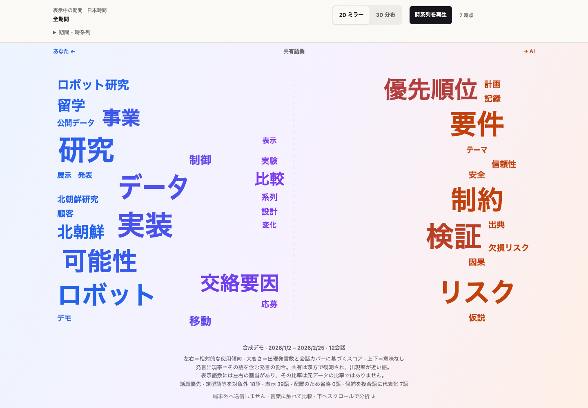

# Promptprint

**AIとの会話から、言葉の指紋を見る。**

Promptprint は、ChatGPT / Claude との会話履歴を端末内だけで解析し、「あなたが持ち込む言葉」「共有された言葉」「AI が返す言葉」を Mirror Cloud として可視化するブラウザアプリです。

- 左: あなたが相対的によく使う言葉
- 中央: 双方で実際に観測され、発言出現率が近い共有語彙
- 右: AI が相対的によく使う言葉
- 大きさ: 出現発言数と会話カバー件数に基づく対数スコア
- 上下: 意味なし
- 色: あなた寄り / 共有 / AI 寄り

単語を押すと、その語が現れた原文の前後を端末内で確認できます。語彙エコー率や AI 先行観測語も、品質評価や因果推論ではなく、読み込んだ会話に見られる語彙上の傾向として表示します。

発言出現率は「その語を含む発言の割合」であり、文章の長さを補正した指標ではありません。片方の発言がない場合は灰色の「比較材料不足」とし、共有とは扱いません。ツールチップと文脈欄には役割別の発言出現率、1,000解析対象語トークンあたりの出現回数、会話カバー件数を表示します。

短い語の出現位置の80%以上が同じ複合語内にある場合は、表示候補を複合語へ代表化します。元の集計値は変えません。左右の表示枠の割当と配置上の省略があるため、表示語数の比率は元データの比率ではありません。収まらない語は反対側へ移さず、共通の文字サイズ調整または省略で対応し、件数を明記します。詳しい数式・閾値・上限は [技術仕様](docs/TECHNICAL_SPEC.md) を参照してください。

本人が明示的に許可した非公開の個人用取得機能は、別ビルドの [Promptprint Private](docs/PRIVATE_LOCAL.md) を参照してください。ChatGPTへの読み取り通信と拡張専用の端末内保存を行います。以下の通常Web版の無送信・無保存とは分離されており、公式連携や公開用機能ではありません。

## 必要な環境

- Node.js 22.12.0 以上（開発時確認: 22.13.0）
- pnpm 11.19.0
- Web Worker、`Intl.Segmenter`、SVG、Canvas を利用できる現行ブラウザ

自動 E2E 検証の対象は Chromium です。Firefox / Safari には同じブラウザ API を前提としますが、現時点では自動回帰テストの対象外です。

依存関係は `pnpm-lock.yaml` で固定されています。

## 話題語の抽出

既定の「話題を優先」は、同梱した日本語の形態素辞書と英語の品詞モデルで、原文に実在する名詞・名詞句を抽出します。助詞・記号・単純応答を表示せず、動詞の活用断片や接尾辞だけで語数を埋めません。複合語は複数の発言で観測されたものに限ります。表示候補は発言数と会話ごとの特徴で選び、左右や文字の大きさを決める計測値とは分離しています。

「使用語を広く」は動詞や手続き的な語も比較できますが、助詞や記号を復活させません。両モードの出現率とトークン頻度は同じ前処理・品詞解析後の語列から計算します。外部LLMや意味の埋め込みは使わず、完全な意味理解・自動要約・表記違いの同一視は行いません。

初回解析では同一配信元の辞書約17.8 MBをWorkerへ読み込みます。展開した辞書は約100 MBで、解析用メモリは別途必要です。英語モデルもビルドに同梱します。CDNへ辞書や会話を取りに行く設計ではありません。個人用拡張では辞書もローカルファイルです。辞書の読み込みに失敗した場合は明示的に停止し、旧方式の結果を代用しません。

## セットアップと起動

```bash
pnpm install
pnpm dev
```

`pnpm dev` が表示したローカル URL をブラウザで開いてください。環境変数、API キー、ログイン、バックエンドは不要です。

Production bundle を確認する場合:

```bash
pnpm build
pnpm preview
```

`pnpm build` は静的ファイルを `dist/` に生成します。

## 使い方

### 合成デモを見る

1. 最初の画面で `デモを見る` を押します。
2. 日本語中心の完全な合成会話が、実ファイルと同じ正規化・分析・レイアウト経路を通ります。
3. Mirror Cloud の語にポインターを重ねるかキーボードでフォーカスすると、役割別の出現数・比率・会話カバー件数を確認できます。
4. 語をクリック、または Enter で開くと、最大20件のローカル文脈を確認できます。Escape で閉じられます。
5. 対象プロバイダー、期間、表示語数、単語/フレーズ、コード・引用除外を変更すると再分析されます。
6. 文脈画面の `この語を表示から隠す` で、センシティブな語を表示と PNG の両方から除外できます。

デモデータは実在人物の会話ではありません。

### 3Dで語の広がりを見る

図の上部の `3D 分布` で切り替え、`2D ミラー` で元に戻せます。

- X：あなた／AIの相対的な使用傾向（−1〜+1）。
- Y：役割別の発言出現率の均等平均（0〜100%）。
- Z：対象会話のうち、その語が現れた割合（0〜100%）。

余白のドラッグ、図にフォーカスして矢印キー、または `視点を操作` のボタンで回転できます。重なる点も `3Dで選ぶ語` から文脈を開けます。大きさは一定、点間距離は語の意味の類似度ではありません。回転後の画面左右ではなくX軸を読んでください。片役割だけの場合は共有ではなく比較材料不足です。

`期間・時系列` の日付絞り込み／日・月単位の再生も3Dのまま使えます。3軸は期間を変えても同じ尺度です。`PNGを書き出す` は現在の表示形式・視点・期間を保存します。2Dと同じ選抜済み語を使い、省略数を表示します。表示切替や回転は再生を止め、外部通信や保存を行いません。

### 会話履歴を読み込む

1. ChatGPT または Claude から取得した `.zip` / `.json` を、ドロップ領域へ置くか `ファイルを選ぶ` から選択します。複数選択もできます。
2. `ファイルを確認中` → `会話を読み込み中` → `テキストを正規化中` → `単語とフレーズを集計中` → `レイアウトを生成中` の順に端末内で処理します。
3. 一部のレコードを読み飛ばした場合は、ダッシュボードの `読み込み診断` に解析数・スキップ数と安全な診断情報が表示されます。
4. 途中で `キャンセル`、分析後に `解析データを消去` を押すと、Worker と画面上の解析状態を破棄して初期画面へ戻ります。
5. `PNGを書き出す` は、タイトル、Mirror Cloud、凡例、集計件数、プライバシー注記だけを含む画像を保存します。

## ChatGPT エクスポート

ChatGPT のエクスポート ZIP をそのまま選ぶか、展開後の `conversations.json` を選択できます。

現在のアダプターは次を扱います。

- conversation オブジェクトのトップレベル配列
- `conversations` 配列を持つラッパー
- `mapping` と `current_node` を持つグラフ形式
- `messages` の直接配列
- ZIP 内の単一または複数の会話 JSON
- `content.parts`、文字列 content、一般的なテキストブロック

グラフ形式では `current_node` から親をたどった現在の枝だけを読み込みます。現在ノードが使えない場合は、利用可能な leaf を最終メッセージ日時、利用可能メッセージ数、枝の長さの順で比較する決定論的フォールバックを行い、診断を表示します。破棄された別枝をすべて混ぜることはありません。

ユーザーと assistant のテキストだけを対象にし、system / developer / context、tool 呼び出し・結果、実行出力、空メッセージ、テキストのない添付を除外します。タイトルや日時が欠けていても、読み取れる会話は安定した順序で処理します。

## Claude エクスポート（実験的）

Claude の ZIP または JSON も選択できますが、対応は **実験的** です。エクスポート形式の変更やアカウント種別によって、一部または全部を読み取れない可能性があります。

現在は次のような一般的な形を保守的に検出します。

- トップレベル配列、`conversations`、または `chats`
- `chat_messages` または `messages`
- `sender`、`role`、または `author.role`
- `human` / `user` と `assistant` / `ai` / `claude`
- 文字列 `text` / `content` と一般的な text block 配列

対応していない形では推測で私的データを掘り起こさず、ルート型と認識済みの構造キーだけを診断に表示します。キー確認は先頭64件、表示は12件までで、任意の未知キー名や値は表示しません。新しい形式の報告には、本文を除去した匿名スキーマ例を使用してください。

## 対応形式と安全上限

UI から選べる拡張子は `.json` と `.zip` です。JSON は UTF-8 を想定します。

| 対象 | 現在の上限・挙動 |
| --- | --- |
| 一度に選択するファイル | 32件 |
| 選択ファイルの合計 | 500 MB |
| 1ファイル | 500 MB |
| 生 JSON | 200 MB |
| 大きな ZIP の警告 | 200 MB 超 |
| ZIP 内の全項目 | 4,096件 |
| ZIP 内で調べる JSON | 256件 |
| ZIP 内のJSON 1件（展開後） | 64 MB |
| ZIP 内の対象 JSON 合計（展開後） | 200 MB |
| 1回の取り込みで保持する正規化結果 | 合計20,000会話・200,000メッセージ |
| provider ごとの会話候補 | 20,000会話 |
| 1会話のメッセージ候補 | 100,000件 |
| ChatGPT graph | 200,000 node、fallback候補 5,000枝、fallback走査 1,000,000 step |
| 1メッセージのテキスト抽出 | 深さ6、4,096項目、256 text block、最大1,000,000文字 |
| 読み込む日時 | Unix epoch から 3000-01-01 UTC まで（範囲外は日時なしとして扱う） |
| 解析に使う1メッセージ | 100,000文字 |
| フレーズ抽出 | 1メッセージ先頭5,000 token、候補20,000件、保存 occurrence 500,000件 |
| 文脈表示 | 原文先頭200,000文字を検索し、1語あたり最大20件、各抜粋は約190文字 |

ZIP では隠しファイル、`__MACOSX`、ディレクトリ、JSON 以外の素材を無視します。`conversations.json`、`chats.json`、番号付きファイルなど会話らしい名前の JSON があれば、それらをすべて対象にします。ほかの JSON は読み飛ばした件数と安全なファイル名を診断へ記録します。会話らしい名前が一つもない場合だけ、上限内の JSON を形式判定します。ChatGPT の現在分岐を復元できない場合は安全上限内の候補から決定し、5,000枝を超えて省略した候補数も診断します。

上限を超えたファイル、壊れた JSON / ZIP、空の ZIP、無関係な JSON は、画面全体を落とさず日本語の回復可能なエラーとして扱います。

## ブラウザ内プライバシー

この実装では、読み込んだ履歴を含む外部リクエストを行いません。

- File のバイト列はブラウザから専用 Web Worker へ渡され、ZIP 展開・provider 判定・正規化・集計・レイアウトはブラウザプロセス内で実行されます。
- 原文は文脈表示と再分析のため、ページを開いている間だけ React / Worker の揮発メモリに存在します。
- raw conversation を `localStorage`、IndexedDB、Cookie、Service Worker cache へ保存するコードはありません。
- analytics、telemetry、外部エラー報告、外部フォント、CDN runtime、第三者 API を使用しません。
- PNG は集計語と件数から 2,200 × 1,340 の Canvas 上で新規生成され、原文抜粋・会話タイトル・メールアドレスを描画しません。隠した語は再分析結果から外れます。
- PNG 用 object URL はダウンロード後に revoke されます。消去操作が画像生成中に行われた場合は生成を中止し、遅れてダウンロードを開始しません。
- 分析フッターの `解析データを消去` は、二段階確認後に専用 Worker と進行中の PNG 生成を終了し、会話、文脈 index、診断、フィルター、選択状態を画面メモリから破棄します。ページの再読み込みでも揮発状態は失われます。

この保証は **Promptprint アプリの実行時コード** に対するものです。`pnpm install` 時のパッケージ取得、ブラウザ拡張、OS、画面収録、バックアップ、利用者が保存・共有した PNG までは制御しません。また、集計語そのものが関心分野を示す可能性があるため、共有前に画像を確認し、必要な語を隠してください。

E2E テストでは同一オリジンのローカルテストサーバー以外へのリクエストと browser console error を検出します。また、合成デモと実データ形状の取り込み後に local/session storage、Cookie、IndexedDB、Cache、Service Worker が空であること、隠した語と import fixture の原文・タイトル・メールアドレスが Canvas 描画文字列へ入らないことを確認します。

## PNG とスクリーンショット

`PNGを書き出す` で保存されるファイル名は `promptprint-YYYY-MM-DD.png` です。

Playwright のデモテストは、1440 × 1000 のブラウザで次の画像を生成します。



画像がまだ存在しない場合は、Playwright の Chromium を用意したうえで `pnpm e2e` を実行してください。

## 開発コマンド

| コマンド | 内容 |
| --- | --- |
| `pnpm dev` | Vite 開発サーバーを起動 |
| `pnpm build` | TypeScript project build と Vite production build |
| `pnpm preview` | `dist/` のローカル preview |
| `pnpm typecheck` | TypeScript 型検査 |
| `pnpm lint` | ESLint（warning も失敗扱い） |
| `pnpm test` | Vitest unit tests を1回実行 |
| `pnpm test:watch` | Vitest watch mode |
| `pnpm e2e` | Playwright Chromium E2E。`127.0.0.1:4173` の Vite server は自動起動 |
| `pnpm check` | typecheck → lint → unit test → build |

Playwright の Chromium が未導入の場合だけ、最初に実行します。

```bash
pnpm exec playwright install chromium
```

推奨の確認順:

```bash
pnpm install
pnpm typecheck
pnpm lint
pnpm test
pnpm build
pnpm e2e
pnpm check
```

`pnpm check` に E2E は含まれないため、`pnpm e2e` は別に実行してください。

## 既知の制限

分かち書き・フレーズ抽出はヒューリスティックです。頻度は重要性や正しさではなく、語彙エコー率は回答品質ではありません。AI 先行観測語は時系列上の関連であり、AI が語を教えたという因果を証明しません。provider のエクスポート形式、端末性能、ブラウザのフォント描画によっても見え方や対応可否が変わります。

詳しくは [docs/LIMITATIONS.md](docs/LIMITATIONS.md) を参照してください。設計と数式は [docs/ARCHITECTURE.md](docs/ARCHITECTURE.md)、受入条件は [docs/ACCEPTANCE.md](docs/ACCEPTANCE.md) にあります。

## 話題が分かる語を優先

標準は「話題を優先」です。今回・内容・確認などの定型的な進行語を表示候補から外し、実際に使われた話題語の候補を選びます。語が少なければ表示枠を埋めません。「表示条件を変える → 語の選び方 → 使用語を広く」で、AIの返し方を含む元の候補を確認できます。左右・頻度の集計は切替で変わりません。単語の意味理解ではなく、端末内の限定的な抽出規則です。
